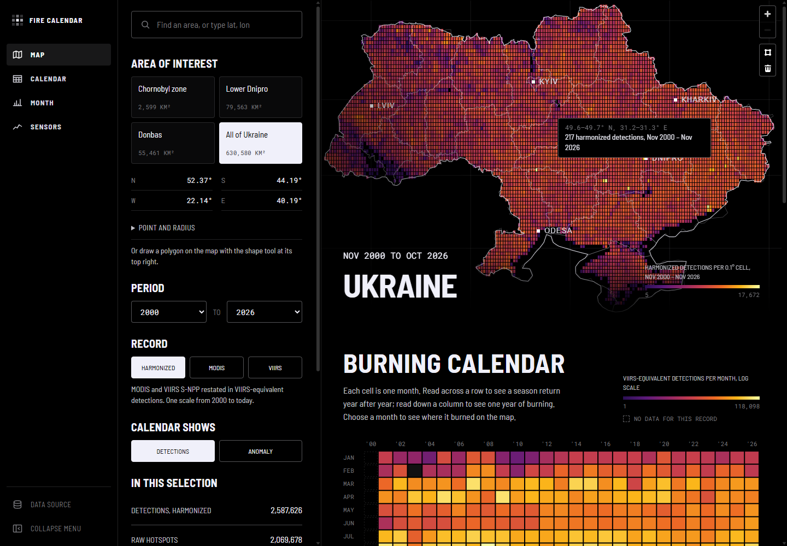

<div align="center">

# 🔥 Fire Calendar

**Twenty-five years of fire over Ukraine, on one consistent scale.**

MODIS and VIIRS hotspots harmonized into a single monthly record from 2000 to today.<br>
Pick any area, read its burning calendar, spot the anomalies.

NASA Space Apps Challenge 2026 · *Harmonization of MODIS and VIIRS Hot Spots* · team **Glushkov45learners**




</div>

## Why

Raw satellite fire counts over Ukraine jump every time a new sensor comes online, not when fires change:

| Year | Step in the raw data |
|------|----------------------|
| 2002 | Aqua joins Terra (MODIS) |
| 2012 | VIIRS S-NPP launches |
| 2018 | NOAA-20 launches |
| 2023 | NOAA-21 launches |

Fire Calendar restates MODIS and VIIRS S-NPP in **VIIRS-equivalent detections**, so a spring in 2004 and a spring in 2024 can be compared honestly.

## Features

- **Fire map:** harmonized detections on a 0.1° grid, with a hover readout per cell.
- **Area of interest:** presets (Chornobyl zone, Lower Dnipro, Donbas, all of Ukraine), place search, lat/lon, a point and radius, or a polygon you draw on the map.
- **Burning calendar:** one cell per month, rows are months and columns are years, so fire seasons line up at a glance.
- **Anomaly mode:** each month against its own baseline norm, on a diverging scale.
- **Record switch:** harmonized, raw MODIS or raw VIIRS.
- **This month:** a drill-down on the chosen month, explained in plain words.
- **Two sensors, one record:** yearly totals showing the sensor steps and the harmonized line that removes them.
- **CSV export** of the selection, and a **monthly digest** e-mail sign-up.
- Shareable URLs, keyboard navigation, mobile layout.

## Quick start

```bash
npm install
npm run dev
```

Open http://localhost:5173.

No backend? Set `VITE_USE_MOCKS=true` in `.env.development.local`. The dev server then answers `/api/v1` itself from `src/shared/api/mocks`.

### Environment

| Variable | Default | What it does |
|----------|---------|--------------|
| `VITE_API_URL` | `/api/v1` | API base path. Keep it relative: the API must be on the app's origin. |
| `API_PROXY_TARGET` | `http://localhost:8080` | Dev only: where Vite forwards `/api`. |
| `VITE_USE_MOCKS` | `false` | `true` serves contract-3 mock responses from the dev server. |

## Scripts

| Command | |
|---------|--|
| `npm run dev` | Dev server with the API proxy, or mocks |
| `npm run build` | Type-check and build to `dist/` |
| `npm run preview` | Serve the production build |
| `npm run lint` | Oxlint plus Steiger (Feature-Sliced rules) |
| `npm run selfcheck` | Assertions for geometry, series rules, anomaly wording and the API boundary |
| `npm run e2e` | Browser checks over Chrome DevTools, against the mocks |

## Architecture

The code follows [Feature-Sliced Design](https://feature-sliced.design):

```
src/
├── app/        entry, router, global styles
├── pages/      home
├── widgets/    fire-map, burn-calendar, this-month, sensors-chart, control-panel, …
├── features/   draw-area, search-area, select-period, select-record, export-csv, …
├── entities/   analysis, aoi, meta
└── shared/     api client, config, lib, ui
```

Where it sits in the system:

```
FIRMS CSV ─► ETL ─► harmonization model ─► PostgreSQL + PostGIS ─► API /api/v1 ─► Fire Calendar
```

## Deploy

```bash
docker build -t fire-calendar-frontend .
docker run -p 8080:8080 fire-calendar-frontend
```

nginx serves the static build on `:8080`. The API is not proxied in this container: a reverse proxy (Caddy) puts `/api/*` and the app on one origin, so no CORS is needed.

## Data

Fire detections come from [NASA FIRMS](https://firms.modaps.eosdis.nasa.gov/): MODIS (Terra and Aqua) and VIIRS S-NPP. Coverage is Ukraine, bbox `22.0, 44.0, 40.3, 52.4`, with days counted in UTC.
